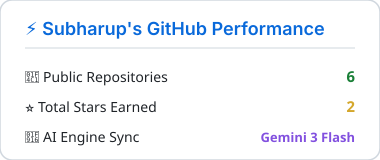

  <!-- Self-hosted, theme-adaptive vector banner -->
  

---

### 📊 Real-Time Performance & Metrics *(Locally Generated SVGs)*

  
  

---

<!-- AUTO-SUMMARY:START -->

### ⚡ Dynamic Technical Arsenal

| Area | Detected Technologies & Frameworks |
| :--- | :--- |
| **Languages** | TypeScript, Python, JavaScript (ES6+), SQL, HTML5, CSS3 |
| **Frontend & UI** | React 19, Next.js 16 (App Router), Tailwind CSS v4, Framer Motion, Vite 8, Responsive Design, WCAG-compliant UI |
| **Backend & Systems** | Node.js, Flask, Prisma ORM, Cloudflare Workers (Serverless), PostgreSQL (TCP Connection Pooling), SQLite3, Cloudflare D1, Workers AI (Llama 3.1) |
| **DevOps & Security** | Cloudflare Pages, Edge Prerendering, XDR (Extended Detection and Response), SOC Automation, Vulnerability Scanning, Malware Signature Analysis, Turbopack |

### 🚀 Automated Repository Digest

Subharup Biswas is a sophisticated systems builder and full-stack engineer with a pronounced focus on high-performance edge computing and cybersecurity. Their portfolio demonstrates an early adoption of bleeding-edge technologies, notably React 19 and Next.js 16, utilized to build production-grade SaaS platforms and networking tools. The engineering patterns observed across their repositories emphasize "Edge-First" architecture, leveraging Cloudflare’s ecosystem (Workers, D1, Pages) to deliver sub-second response times and 100/100 Lighthouse performance scores.

Beyond frontend excellence, Subharup exhibits deep technical proficiency in systems security and automated monitoring. From building enterprise-grade XDR platforms with modular Python engines to implementing AI-driven root cause analysis using LLM waterfalls (Gemini/Groq), their work bridges the gap between traditional software engineering and advanced security operations. There is a consistent commitment to "Platform Polish," evidenced by meticulous localization engineering, deterministic mathematical fallbacks in AI forecasting, and high-contrast, accessible design systems.

*   **[PulsePing](https://github.com/SubharupBiswas/pulseping)**
    *   **Architectural Highlight:** A serverless operational monitoring SaaS featuring an AI-driven root cause analysis engine that utilizes a "waterfall" model (Gemini → OmniRoute → Groq) to optimize API costs.
    *   **Key Feature:** Implements inverse background job heartbeats and zero-downtime public status boards using Prisma ORM and PostgreSQL with local TCP connection pooling.

*   **[VULNEXUS](https://github.com/SubharupBiswas/VULNEXUS)**
    *   **Architectural Highlight:** An enterprise-grade XDR (Extended Detection and Response) platform built with a modular Python engine for local network vulnerability scanning and malware analysis.
    *   **Key Feature:** Features a re-engineered IST localization system for unified backend audit logging and a real-time SOC web control center.

*   **[RupeeCheck-AI](https://github.com/SubharupBiswas/RupeeCheck-AI)**
    *   **Architectural Highlight:** A 100% free-tier serverless edge application tracking FX rates using Cloudflare Workers and D1 SQLite.
    *   **Key Feature:** Integrates Workers AI (Llama 3.1 8B) for 30-day rate forecasting with deterministic mathematical fallbacks and automated multi-channel alert dispatchers (Telegram/Discord).

*   **[cidr-subnet-calculator](https://github.com/SubharupBiswas/cidr-subnet-calculator)**
    *   **Architectural Highlight:** A high-performance networking engine designed for IPv4 CIDR calculations and VLSM planning, achieving perfect 100/100 Lighthouse scores across all categories.
    *   **Key Feature:** Includes a unique binary stream topology visualizer and an embeddable tech guide for network engineers.

<!-- AUTO-SUMMARY:END -->

---

### 📬 Connect & Collaborate

- **LinkedIn:** [linkedin.com/in/subharupbiswas](https://linkedin.com/in/subharupbiswas)
- **Email:** [contact@subharup.com](mailto:contact@subharup.com)
- **Portfolio:** [subharup.com](https://subharup.com)