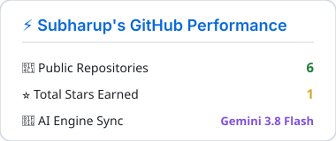
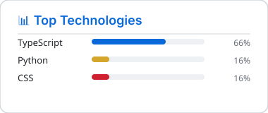

  <!-- Self-hosted, theme-adaptive vector banner -->
  

---

### 📊 Real-Time Performance & Metrics *(Locally Generated SVGs)*

  
  

---

<!-- AUTO-SUMMARY:START -->

### ⚡ Dynamic Technical Arsenal

| Area | Detected Technologies & Frameworks |
| :--- | :--- |
| **Languages** | TypeScript, Python, JavaScript (ES6+), HTML5, CSS3, SQL |
| **Frontend & UI** | React 19, Next.js 16 (App Router, Turbopack), Tailwind CSS v4, Framer Motion, Vite 8, Semantic HTML |
| **Backend & Systems** | Node.js, Prisma ORM, Flask, Cloudflare Workers, Cloudflare D1 (SQLite), PostgreSQL (TCP Connection Pooling), SQLite3, Llama 3.1 8B (Workers AI) |
| **DevOps & Security** | Cloudflare Pages, Edge Computing, Extended Detection & Response (XDR), Threat Intelligence Lookup, Root-Cause Analysis Fallbacks (Gemini/Groq), Automated Alerting (Telegram/Discord APIs) |

---

### 🚀 Automated Repository Digest

Subharup Biswas demonstrates an engineering focus centered on edge-native serverless systems, resilient distributed architectures, and systems-level network tooling. Across the portfolio, projects consistently feature modern foundational frameworks—notably React 19, Next.js 16, and modern Tailwind CSS v4—coupled with edge computing layers like Cloudflare Workers and D1 SQLite. The repositories emphasize production hardening, sub-second latency, deterministic failovers (such as multi-LLM waterfall architectures), and strict adherence to web accessibility, WCAG standards, and clean API design.

Beyond user interfaces, the codebases reflect strong domain knowledge in network topologies, real-time telemetry, and cybersecurity operations. From building bitwise binary subnet calculation engines to engineering Python-driven XDR vulnerability scanners and automated uptime heartbeats, Subharup's work emphasizes deterministic reliability, operational visibility, and local timezone telemetry without inflating overhead or infrastructure costs.

#### Featured Projects

* **[PulsePing](https://github.com/SubharupBiswas/pulseping)**
  * Enterprise-grade serverless uptime, latency tracking, and background job heartbeat platform.
  * Powered by Next.js 16 (Turbopack), Prisma ORM, and local TCP connection-pooled PostgreSQL.
  * Features multi-model AI root-cause analysis (Gemini → OmniRoute → Groq waterfall fallback) and zero-downtime public status boards.

* **[RupeeCheck-AI](https://github.com/SubharupBiswas/RupeeCheck-AI)**
  * 24/7 edge-based USD/INR foreign exchange rate tracker and 30-day forecasting engine.
  * Hosted entirely on Cloudflare Workers, Cloudflare D1 (SQLite), Vite, and Meta Llama 3.1 8B via Workers AI.
  * Employs deterministic mathematical fallback forecasting and automated dispatch pipelines to Telegram and Discord.

* **[cidr-subnet-calculator](https://github.com/SubharupBiswas/cidr-subnet-calculator)**
  * High-performance IPv4 CIDR subnet calculation engine and binary stream topology planner (`subnetmask.tech`).
  * Built using Next.js 16, React 19, and Tailwind CSS v4, optimized for sub-millisecond network computation.
  * Boasts 100/100 Lighthouse performance metrics across mobile and desktop with full WCAG AA/AAA compliance.

* **[VULNEXUS](https://github.com/SubharupBiswas/VULNEXUS)**
  * Extended Detection and Response (XDR) cybersecurity control plane designed for endpoint and network security.
  * Implemented in modular Python with Flask and SQLite3 for local network audits, threat intelligence lookup, and malware signature checks.
  * Features unified Asia/Kolkata (IST) database audit trails and live SOC configuration auditing.

<!-- AUTO-SUMMARY:END -->

---

### 📬 Connect & Collaborate

- **LinkedIn:** [linkedin.com/in/subharupbiswas](https://linkedin.com/in/subharupbiswas)
- **Email:** [contact@subharup.com](mailto:contact@subharup.com)
- **Portfolio:** [subharup.com](https://subharup.com)