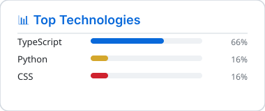

  <!-- Self-hosted, theme-adaptive vector banner -->
  

---

### 📊 Real-Time Performance & Metrics *(Locally Generated SVGs)*

  
  

---

<!-- AUTO-SUMMARY:START -->

### ⚡ Dynamic Technical Arsenal

| Area | Detected Technologies & Frameworks |
| :--- | :--- |
| **Languages** | TypeScript, Python, JavaScript, HTML5, CSS3, SQL |
| **Frontend & UI** | React 19, Next.js 16 (App Router & Turbopack), Vite, Tailwind CSS v4, Framer Motion |
| **Backend & Systems** | Cloudflare Workers, Flask, Prisma ORM, PostgreSQL, Cloudflare D1 (SQLite), SQLite3, Edge Serverless Compute |
| **DevOps & Security** | Cloudflare Pages, Edge Prerendering, XDR Threat Intelligence, Malware Signature Analysis, OS Auditing, AI Fallback Waterfalls (Llama 3.1 8B, Gemini, Groq), Webhook Integrations |

### 🚀 Automated Repository Digest

Subharup Biswas demonstrates an exceptional command over edge-first distributed systems, operational monitoring platforms, modern full-stack engineering, and security tooling. Across the portfolio, there is a distinct emphasis on high-availability serverless architectures (Cloudflare Workers, Cloudflare Pages), next-generation frontend frameworks (React 19, Next.js 16, Tailwind CSS v4), and cost-optimized multi-provider AI integrations—such as fallback LLM waterfalls and edge-native model execution using Workers AI (Llama 3.1 8B).

The codebases showcase a deep commitment to performance engineering, operational robustness, and user experience. Core technical strengths include architecting sub-second status boards, engineering custom cybersecurity detection engines with OS configuration auditing, building zero-latency binary visualization tools, and consistently achieving perfect 100/100 Lighthouse performance, accessibility, and SEO metrics.

*   **[pulseping](https://github.com/SubharupBiswas/pulseping)** — Serverless uptime and latency monitoring platform built with Next.js 16 and Prisma/PostgreSQL, featuring background heartbeat tracking, sub-second public status boards, and automated AI root-cause analysis via a cost-optimized multi-provider fallback waterfall.
*   **[RupeeCheck-AI](https://github.com/SubharupBiswas/RupeeCheck-AI)** — Serverless edge financial intelligence tool running on Cloudflare Workers and D1, providing 24/7 USD/INR spot tracking, edge-deployed LLM forecasting with deterministic fallback models, and automated multi-channel alert dispatching.
*   **[VULNEXUS](https://github.com/SubharupBiswas/VULNEXUS)** — Enterprise-grade Extended Detection and Response (XDR) platform powered by a modular Python/Flask engine for local network vulnerability scanning, threat intelligence lookup, malware signature analysis, and OS auditing.
*   **[cidr-subnet-calculator](https://github.com/SubharupBiswas/cidr-subnet-calculator)** — High-performance IPv4 CIDR subnet engine and VLSM planner featuring dynamic binary stream topology visualizers and benchmarked 100/100 Lighthouse audits across all categories.

<!-- AUTO-SUMMARY:END -->

---

### 📬 Connect & Collaborate

- **LinkedIn:** [linkedin.com/in/subharupbiswas](https://linkedin.com/in/subharupbiswas)
- **Email:** [contact@subharup.com](mailto:contact@subharup.com)
- **Portfolio:** [subharup.com](https://subharup.com)