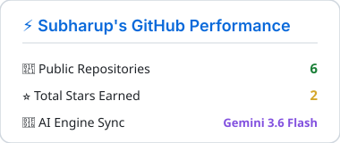
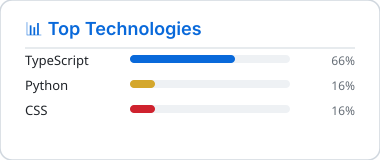

  <!-- Self-hosted, theme-adaptive vector banner -->
  

---

### 📊 Real-Time Performance & Metrics *(Locally Generated SVGs)*

  
  

---

<!-- AUTO-SUMMARY:START -->

### ⚡ Dynamic Technical Arsenal

| Area | Detected Technologies & Frameworks |
| :--- | :--- |
| **Languages** | TypeScript, Python, JavaScript, HTML5, CSS3 |
| **Frontend & UI** | React 19, Next.js 16 (Turbopack), Tailwind CSS v4, Vite, Framer Motion |
| **Backend & Systems** | Cloudflare Workers, Flask, Prisma ORM, PostgreSQL, SQLite, Cloudflare D1 |
| **DevOps & Security** | Cloudflare Pages, Edge Computing, Cloudflare Workers AI (Llama 3.1), Gemini / Groq Waterfall Integration, Extended Detection & Response (XDR), Vulnerability Auditing |

---

### 🚀 Automated Repository Digest

Subharup Biswas demonstrates a strong engineering profile centered on modern edge computing, serverless architectures, cybersecurity infrastructure, and high-performance frontend engineering. The repositories reveal a distinct focus on building production-ready, low-latency applications leveraging cutting-edge web stacks (Next.js 16, React 19, TypeScript, Tailwind CSS v4) alongside robust edge platforms like Cloudflare Workers and D1. Across multiple projects, there is a recurring emphasis on performance optimization—achieving top-tier PageSpeed metrics, implementing sub-second response targets, and delivering responsive, accessibility-compliant user interfaces.

Beyond frontend systems, the developer showcases expertise in full-stack backend mechanics, database ORMs, and AI integration pipelines. The codebases span real-time operational monitoring with multi-provider AI root-cause analysis, 24/7 financial tracking with edge-deployed LLMs, network topology engines, and enterprise security platforms handling OS auditing and threat intelligence. This balance of systems-level networking knowledge and modern cloud-native development highlights an engineer capable of designing scalable, secure, and resilient software end-to-end.

#### Featured Repositories

- **[PulsePing](https://github.com/SubharupBiswas/pulseping)**
  - Enterprise-grade serverless uptime, latency, and background job heartbeat tracking platform.
  - Built with Next.js 16 (Turbopack), React 19, Prisma ORM, and PostgreSQL.
  - Features an automated, cost-aware multi-provider AI root-cause analysis waterfall engine (Gemini → OmniRoute → Groq).
  - Delivers sub-second, zero-downtime public status dashboards.

- **[RupeeCheck-AI](https://github.com/SubharupBiswas/RupeeCheck-AI)**
  - 100% free-tier serverless edge application for 24/7 USD/INR exchange rate tracking and forecasting.
  - Powered by Cloudflare Workers, Cloudflare D1 SQLite, and Workers AI running Llama 3.1 8B.
  - Implements deterministic mathematical fallback algorithms alongside LLM predictions.
  - Integrates automated multi-channel alert dispatching to Telegram and Discord.

- **[VULNEXUS](https://github.com/SubharupBiswas/VULNEXUS)**
  - Modular Extended Detection and Response (XDR) platform for cross-platform network security analysis.
  - Engineered with Python, Flask, and SQLite for local vulnerability scanning, threat intelligence, and OS auditing.
  - Features precise Asia/Kolkata (IST) temporal localization across backend triggers, database hooks, and UI clocks.
  - Serves dynamic security operations center (SOC) capabilities through an intuitive web control center.

- **[cidr-subnet-calculator](https://github.com/SubharupBiswas/cidr-subnet-calculator)**
  - High-performance IPv4 CIDR subnet engine, VLSM planner, and binary topology visualizer.
  - Built using Next.js 16, React 19, and Tailwind CSS v4.
  - Benchmarked to 100/100 Google PageSpeed scores across Performance, Accessibility, Best Practices, and SEO.
  - Fully WCAG AA/AAA compliant UI for network architecture planning.

<!-- AUTO-SUMMARY:END -->

---

### 📬 Connect & Collaborate

- **LinkedIn:** [linkedin.com/in/subharupbiswas](https://linkedin.com/in/subharupbiswas)
- **Email:** [contact@subharup.com](mailto:contact@subharup.com)
- **Portfolio:** [subharup.com](https://subharup.com)